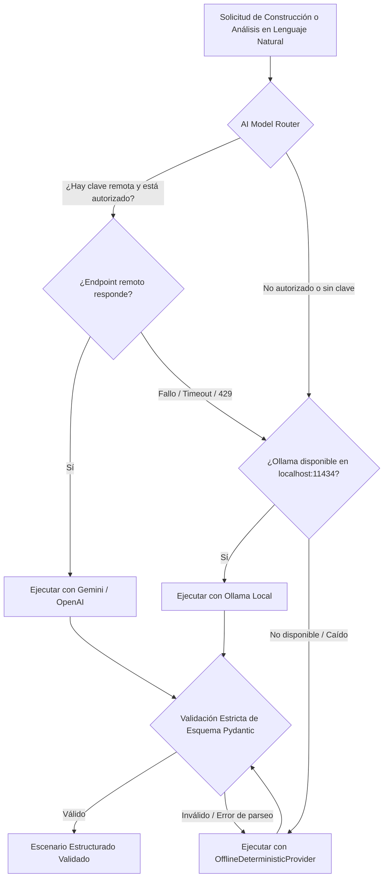

# EVALUACIÓN DE PROVEEDORES DE INTELIGENCIA ARTIFICIAL (AI PROVIDER EVALUATION)
## SALTBOR PHASE 1.15 — INDEPENDENCIA, DISPONIBILIDAD, PRIVACIDAD Y RESILIENCIA

### 1. Marco de Evaluación

Para garantizar que SALTBOR sea una plataforma científica, reproducible, local-first y operable en cualquier entorno de investigación (incluyendo instituciones con políticas de aislamiento de red o presupuesto cero), se evaluaron tres categorías de proveedores de inferencia y extracción:

1. **Proveedor Heurístico Determinista Nativo (`OfflineDeterministicProvider`)**:
   - *Mecanismo*: Motor de reglas gramaticales, tokenización léxica y reconocimiento de entidades basado en el catálogo oficial de El Salvador (D.L. 762).
   - *Latencia*: $< 1\text{ ms}$.
   - *Disponibilidad*: $100\%$ garantizada, sin dependencias externas, sin conexión a Internet, sin necesidad de GPU ni procesos secundarios.
   - *Costo*: $\$0.00$.
   - *Privacidad*: $100\%$ local.
   - *Rol*: **Base obligatoria y fallback universal incondicional**.

2. **Proveedor Local de Código Abierto (`OllamaProvider` / `LocalLLMProvider`)**:
   - *Mecanismo*: Inferencia HTTP local vía daemon Ollama (`http://localhost:11434/api/generate` o `/api/chat`) sobre modelos cuantizados (Llama 3.2 3B/8B, Mistral 7B, Qwen 2.5 7B).
   - *Latencia*: $150\text{ ms} - 1,500\text{ ms}$ dependiendo del hardware (CPU AVX2 vs GPU CUDA/DirectML).
   - *Disponibilidad*: Condicionada a la instalación y arranque previo del servicio Ollama por parte del usuario.
   - *Costo*: $\$0.00$ por token; consumo moderado de memoria RAM/VRAM ($2\text{ GB} - 6\text{ GB}$).
   - *Privacidad*: $100\%$ local, sin telemetría ni transmisión de datos fuera de la máquina anfitriona.
   - *Rol*: **Proveedor preferido para tareas cualitativas cuando está activo localmente**.

3. **Proveedores Remotos en la Nube (`GeminiAPIProvider` / `OpenAIAPIProvider`)**:
   - *Mecanismo*: Solicitudes HTTPS a endpoints de Google Gemini (`generativelanguage.googleapis.com`) u OpenAI (`api.openai.com`) utilizando APIs estándar REST / SDK.
   - *Latencia*: $400\text{ ms} - 3,000\text{ ms}$ sujeta a conexión de red y carga del servidor remoto.
   - *Disponibilidad*: Requiere acceso a Internet, resolución DNS y claves válidas (`GEMINI_API_KEY`, `OPENAI_API_KEY`).
   - *Costo*: Sujeto a cuotas por millón de tokens según tarifas de mercado.
   - *Privacidad*: Los datos de la consulta salen del host. Se impone el protocolo de **minimización de datos**: prohibido enviar identificadores personales, nombres individuales, números de cédula o identidades de agentes sintéticos. Solo se transmiten descripciones genéricas del escenario.
   - *Rol*: **Proveedor opcional para razonamiento contrafactual avanzado, estrictamente bajo autorización y configuración explícita del usuario**.

---

### 2. Tabla Comparativa de Factores Críticos

| Criterio | Offline Determinista (Nativo) | Ollama Local (Llama 3.2) | Gemini API (1.5 Flash/Pro) | OpenAI API (GPT-4o) |
| :--- | :--- | :--- | :--- | :--- |
| **Dependencia Externa** | Ninguna (librería estándar Python) | Ollama instalado y en ejecución | Clave API + Acceso a Internet | Clave API + Acceso a Internet |
| **Tiempo de Respuesta (p95)** | $< 1\text{ ms}$ | $\approx 450\text{ ms}$ | $\approx 850\text{ ms}$ | $\approx 1,100\text{ ms}$ |
| **Tolerancia a Caídas de Red** | Absoluta | Absoluta | Nula (falla si cae la red) | Nula (falla si cae la red) |
| **Riesgo de Alucinación Numérica** | Cero (valores reglados y validados) | Bajo/Medio (mitigado con JSON schema) | Bajo (mitigado con JSON schema) | Bajo (mitigado con JSON schema) |
| **Control Contable y Seguridad** | Total (no tiene acceso a estado) | Total (validación estricta de schema) | Total (validación estricta de schema) | Total (validación estricta de schema) |
| **Reproducibilidad Científica** | 100% determinista | Dependiente de semilla y temperatura | Variable por versión de modelo remoto | Variable por versión de modelo remoto |

---

### 3. Protocolo de Resiliencia y Fallback Transparente

### 4. Directiva de Seguridad y Cumplimiento
- **Regla de Oro**: Ningún error de red, expiración de token o caída de API externa impedirá jamás la ejecución de simulaciones territoriales en SALTBOR.
- Si todas las APIs remotas y Ollama están apagados, el sistema opera con el 100% de sus capacidades científicas mediante el `OfflineDeterministicProvider`.
