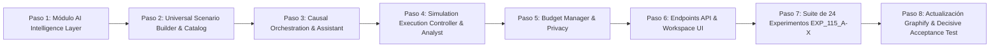

# PLAN DE IMPLEMENTACIÓN — SALTBOR FASE 1.15
## CAPA DE INTELIGENCIA ARTIFICIAL, GENERACIÓN UNIVERSAL DE ESCENARIOS Y ORQUESTACIÓN AUTÓNOMA

**Fecha**: Noviembre 2026  
**Objetivo Central**: Permitir a cualquier usuario describir escenarios territoriales en lenguaje natural para cualquier cantón salvadoreño, traducirlos a especificaciones estructuradas y ejecutarlos deterministamente sobre los motores existentes de SALTBOR sin programar clases Python específicas.

---

### 1. Fases de Desarrollo

#### Paso 1: Módulo `saltbor/ai/` (Capa de Inteligencia Modular)
- `saltbor/ai/providers/base.py`: Interfaz abstracta `AIProvider`, dataclass `AIRequest`, `AIResponse`, `UsageMetrics`.
- `saltbor/ai/providers/deterministic.py`: `OfflineDeterministicProvider` (parser sintáctico-semántico de lenguaje natural a escenarios estructurados, extracción de entidades territoriales salvadoreñas, cero dependencias de red).
- `saltbor/ai/providers/ollama.py`: `OllamaProvider` con verificación de salud, timeouts y structured outputs.
- `saltbor/ai/providers/remote.py`: `RemoteProvider` (Gemini y OpenAI) con manejo de errores, rate-limits y datos anonimizados.
- `saltbor/ai/router.py`: `AIModelRouter` con enrutamiento por tipo de tarea, complejidad, disponibilidad y fallback automático.
- `saltbor/ai/budget.py`: `AIComputeBudgetManager` (control de cuotas, tokens, contabilidad de costos, caché in-memory).
- `saltbor/ai/context.py`: `AIMemoryAndContext` (separación estricta de base de conocimiento del código, ontología territorial, catálogo causal e identidades sintéticas).

#### Paso 2: Generador Universal de Escenarios en Lenguaje Natural
- `saltbor/ai/scenario_builder.py`: `NaturalLanguageScenarioBuilder`.
  - Recibe cadenas de texto libres en español/inglés.
  - Extrae objetivo geográfico (validado con `territory_data.py`), tipo de evento, intensidad, duración, precondiciones, cohortes afectadas.
  - Formula `UniversalScenarioDefinition` (esquema Pydantic validado).
  - Identifica información faltante e incertidumbres sin inventar datos.
- `saltbor/territory/territory_catalog.py`: `TerritoryCatalogService` (provee información de cobertura para todos los cantones, municipios y distritos de El Salvador).

#### Paso 3: Orquestación Causal Dinámica y Asistente de Planificación
- `saltbor/ai/causal_orchestrator.py`: `AICausalOrchestrationAssistant`.
  - Valida mecanismos causales propuestos contra el catálogo científico de SALTBOR (`CAUSAL_MECHANISM_REGISTRY`).
  - Marca hipótesis no fundamentadas como `HYPOTHESIS_PENDING_VALIDATION`.
  - Impide la invención de deltas numéricos arbitrarios.
- `saltbor/ai/planning_assistant.py`: `ScenarioPlanningAssistant`.
  - Sugiere políticas públicas alternativas (reparación vial vs subsidio vs transporte escolar).
  - Distingue recomendaciones de hechos validados.

#### Paso 4: Controlador de Ejecución y Analista de Resultados
- `saltbor/ai/execution_controller.py`: `AISimulationExecutionController`.
  - Máquina de estados: `DRAFT -> VALIDATING -> READY -> RUNNING -> COMPLETED` (con `FAILED`, `CANCELLED`, `NEEDS_USER_INPUT`, `INSUFFICIENT_DATA`).
  - Aislamiento del estado base: ninguna simulación fallida corrompe el mundo real o el baseline.
- `saltbor/ai/results_analyst.py`: `SimulationResultsAnalyst`.
  - Interpreta indicadores finales, desgloses del `VerifiableEconomicLedger`, métricas de Max-Neef y deltas demográficos.
  - Garantiza que cada afirmación numérica provenga de registros verificados.

#### Paso 5: Comparador Contrafactual y Análisis de Sensibilidad
- `saltbor/ai/scenario_comparator.py`: `AIScenarioComparisonAssistant`.
  - Comparativa de Línea Base vs Shock vs Intervenciones con evaluación de heterogeneidad y significancia.

#### Paso 6: Integración en API REST y Espacio de Trabajo Web
- Extender `saltbor/visualization/api.py`:
  - `POST /ai/scenarios/build`
  - `GET /ai/territories/coverage`
  - `POST /ai/scenarios/plan_suggestions`
  - `POST /ai/causal/validate_mechanisms`
  - `POST /ai/execution/start`
  - `GET /ai/execution/status/{task_id}`
  - `POST /ai/results/analyze`
  - `POST /ai/scenarios/compare_ai`
  - `GET /ai/budget/usage`
  - `GET /ai/providers/status`
- Extender `saltbor/visualization/web/index.html` y `app.js`:
  - Panel interactivo `SALTBOR AI SCENARIO LAB` integrado con el Observatorio Territorial.
  - Editor en lenguaje natural, previsualizador geográfico, tabla de cobertura de datos y desglose causal interactivo.

#### Paso 7: Suite Completa de Experimentos Científicos (EXP_115_A a EXP_115_X)
- Implementar los 24 experimentos en `saltbor/simulation/experiments/phase115_ai_experiments.py` y suite de pruebas `tests/test_experiments/test_phase115_ai_experiments.py`.
- Cobertura exhaustiva:
  - `EXP_115_A`: Lenguaje natural a configuración estructurada válida.
  - `EXP_115_B`: Ejecución de nuevo escenario sin código Python ad-hoc.
  - `EXP_115_C`: Ejecución en cantón alternativo (ej. El Rosario / San Gerardo / Arcatao).
  - `EXP_115_D`: Detección de cobertura de datos geográficos.
  - `EXP_115_E`: Preservación de identidades de agentes compartidas.
  - `EXP_115_F`: Consistencia contable estricta en hogares.
  - `EXP_115_G`: Interacción educación-transporte.
  - `EXP_115_H`: Interacción salud-economía doméstica.
  - `EXP_115_I`: Múltiples eventos simultáneos concurrentes.
  - `EXP_115_J`: Efectos causales demorados.
  - `EXP_115_K`: Manejo de datos incompletos.
  - `EXP_115_L`: Rechazo de mecanismos causales no soportados.
  - `EXP_115_M`: Preservación inmutable de línea base.
  - `EXP_115_N`: Reproducibilidad exacta con semillas idénticas.
  - `EXP_115_O`: Divergencia estocástica con semillas distintas.
  - `EXP_115_P`: Continuidad operativa con proveedor de IA caído.
  - `EXP_115_Q`: Operación offline pura y simulación de Ollama.
  - `EXP_115_R`: Detección y rechazo de alucinaciones y JSONs inválidos.
  - `EXP_115_S`: Contabilidad de costos y tokens de IA.
  - `EXP_115_T`: Comparación contrafactual multiescenario.
  - `EXP_115_U`: Ejecución de simulación sin intervención de LLM.
  - `EXP_115_V`: Estabilidad de memoria y rendimiento sostenido.
  - `EXP_115_W`: Generalización geográfica a través de múltiples cantones.
  - `EXP_115_X`: Límites de privacidad y seguridad de datos.

#### Paso 8: Actualización de Graphify, Entregables y Prueba de Aceptación Decisiva
- Reejecutar `graphify update .` y verificar la conectividad de la arquitectura.
- Generar todos los reportes de gobernanza, esquemas universales y matrices requeridas en la Sección 20.
- Ejecutar la prueba de aceptación decisiva con un cantón diferente y escenario completamente nuevo.
