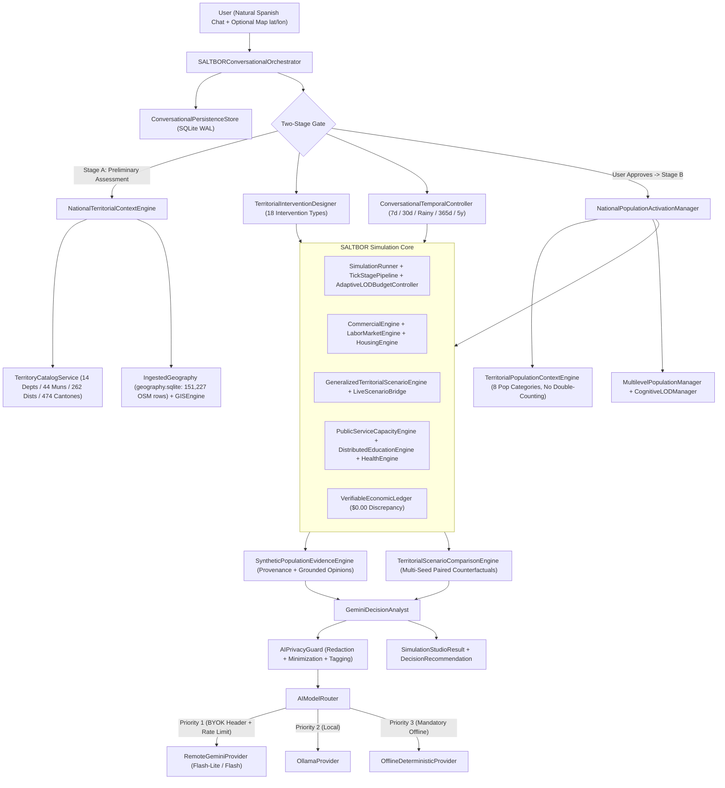

# SALTBOR PHASE 1.16A — SYSTEM ARCHITECTURE

**Version**: Phase 1.16A  
**Entry Point**: Natural-language conversational interface (Spanish-first, map optional, headless-capable)  
**Core Rule**: *Synthetic humans generate simulated behavioral evidence. Simulation engines calculate consequences. Gemini interprets the evidence and assists decision-making.*

---

## 1. High-Level Architectural Flow

---

## 2. Package & Module Organization

All new conversational studio components live in `saltbor/conversational/`, integrating cleanly with existing packages without duplicating functional engines:

| Module | Class(es) | Existing Engines Reused |
| :--- | :--- | :--- |
| [schemas.py](file:///c:/GIT%20HUB/sv%20people/saltbor/conversational/schemas.py) | `ConversationIntent`, `InterventionCategory`, `PopulationCategory`, `ActivationLOD`, `AnalyticalVerdict`, `EvidenceBundle`, `DecisionRecommendation`, `PreliminaryAssessment`, `SimulationStudioResult` | `pydantic>=2.0` |
| [territorial_context.py](file:///c:/GIT%20HUB/sv%20people/saltbor/conversational/territorial_context.py) | `NationalTerritorialContextEngine` | `TerritoryCatalogService`, `IngestedGeography`, `GISEngine` |
| [population_activation.py](file:///c:/GIT%20HUB/sv%20people/saltbor/conversational/population_activation.py) | `NationalPopulationActivationManager`, `TerritorialPopulationContextEngine` | `MultilevelPopulationManager`, `CognitiveLODManager`, `PopulationFactory`, `PopulationRegistry` |
| [temporal_controller.py](file:///c:/GIT%20HUB/sv%20people/saltbor/conversational/temporal_controller.py) | `ConversationalTemporalController` | `SimulationClock`, `SimulationRunner`, `LongitudinalCivilizationEngine` |
| [intervention_designer.py](file:///c:/GIT%20HUB/sv%20people/saltbor/conversational/intervention_designer.py) | `TerritorialInterventionDesigner` | `CommercialEngine`, `BusinessRegistry`, `LaborMarketEngine`, `PublicServiceCapacityEngine`, `LiveScenarioBridge`, `VerifiableEconomicLedger`, `CATEGORY_DEFAULTS` |
| [evidence_engine.py](file:///c:/GIT%20HUB/sv%20people/saltbor/conversational/evidence_engine.py) | `SyntheticPopulationEvidenceEngine` | `SimulationRunner`, `CommercialEngine`, `LaborMarketEngine`, `HousingEngine`, `HealthEngine`, `DistributedEducationEngine`, `VerifiableEconomicLedger`, `CausalEventGraph` |
| [decision_analyst.py](file:///c:/GIT%20HUB/sv%20people/saltbor/conversational/decision_analyst.py) | `GeminiDecisionAnalyst` | `AIModelRouter`, `AIPrivacyGuard`, `AIComputeBudgetManager` |
| [scenario_comparison.py](file:///c:/GIT%20HUB/sv%20people/saltbor/conversational/scenario_comparison.py) | `TerritorialScenarioComparisonEngine` | `VerifiableEconomicLedger`, `GeneralizedTerritorialScenarioEngine`, `SimulationRunner` |
| [persistence.py](file:///c:/GIT%20HUB/sv%20people/saltbor/conversational/persistence.py) | `ConversationalPersistenceStore` | `DatabaseManager`, `SchemaManager` |
| [orchestrator.py](file:///c:/GIT%20HUB/sv%20people/saltbor/conversational/orchestrator.py) | `SALTBORConversationalOrchestrator` | All above + `AIModelRouter` |
| [conversational_studio_router.py](file:///c:/GIT%20HUB/sv%20people/saltbor/visualization/routers/conversational_studio_router.py) | FastAPI Studio Endpoints (`/api/studio/*`) | Mounted in `saltbor/visualization/api.py` |

---

## 3. Level-of-Detail (LOD) Mapping Bridge

Phase 1.16A defines population activation from coarse (`LOD 0`) to detailed (`LOD 3`), whereas `MultilevelPopulationManager` defines `LOD_0_INDIVIDUAL` (finest) to `LOD_4_REGIONAL` (coarsest). The mapping below prevents semantic confusion while reusing both existing managers directly:

| Phase 1.16A `ActivationLOD` | Semantic Meaning | `MultilevelPopulationManager.LODLevel` | `CognitiveLODManager.CognitiveLOD` | Execution Behavior |
| :---: | :--- | :--- | :--- | :--- |
| `LOD 0` | Territorial aggregates | `LOD_3_COMMUNITY` / `LOD_4_REGIONAL` | `LOD_3_DORMANT` (outside focus) | District/canton statistical stocks only; near-zero RAM |
| `LOD 1` | Households & population groups | `LOD_2_COHORT_GROUP` | `LOD_2_EVENT_DRIVEN` | Cohort & household ledgers updated at phase/day boundaries |
| `LOD 2` | Individual agents with summarized activity | `LOD_1_SIMPLIFIED` | `LOD_1_ROUTINE` | Persistent `SyntheticHuman` hydrated; routine daily decisions |
| `LOD 3` | Detailed individual cognition & behavior | `LOD_0_INDIVIDUAL` | `LOD_0_FULL` | Full MAUT, memory encoding, social & commercial evaluation |

---

## 4. Security, Privacy & Anti-Hallucination Boundary

1. **Key Protection**: BYOK Gemini API keys remain in server memory only, transmitted via `x-goog-api-key` HTTP header (never in URL query strings, never embedded in frontend assets, masked as `AIzaSy...XXXX` in status telemetry).
2. **Data Minimization & Redaction**: Before any text leaves the host, `AIPrivacyGuard` redacts DUIs, NITs, phone numbers, email addresses, API key patterns, and non-toponym personal names while preserving valid Salvadoran geographic names (`San José Las Flores`, `Santa Tecla`, `Santa Ana`). Payload size is bounded (`<= 12,000` chars) — full SQLite databases are never transmitted.
3. **Code Safety**: Remote/local LLM outputs are strictly parsed as JSON and validated with Pydantic v2; code-like injection strings (`exec(`, `eval(`, `__import__`, `subprocess`, `os.system`) are rejected.
4. **Numeric Grounding**: `GeminiDecisionAnalyst` passes only verified `EvidenceBundle` statistics and checks LLM claims against observed indicators; if Gemini is offline, rate-limited, or returns invalid schema, `OfflineDeterministicProvider` / grounded deterministic synthesis delivers transparent, exact-number analysis.
