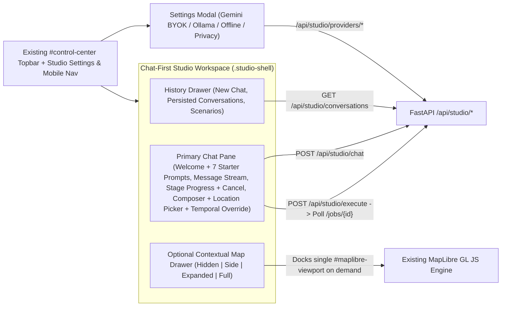

# SALTBOR PHASE 1.16B — UI ARCHITECTURE

**Component Name**: `TerritorialSimulationStudio`  
**Primary View ID**: `#view-studio` (active by default on load)  
**Module**: [territorial_studio.js](file:///c:/GIT%20HUB/sv%20people/saltbor/visualization/web/modules/territorial_studio.js) + [studio.css](file:///c:/GIT%20HUB/sv%20people/saltbor/visualization/web/studio.css)

---

## 1. Layout & Component Topology

---

## 2. Single-Map Reuse Strategy (Zero Duplicate Maps)

Instead of instantiating a second MapLibre GL JS instance, `TerritorialSimulationStudio` reuses the single `#maplibre-viewport` element created by `initOrResizeGIS25D()` in [app.js](file:///c:/GIT%20HUB/sv%20people/saltbor/visualization/web/app.js):
1. On initial load in `#view-studio`, map mode is **`hidden`**, so `initOrResizeGIS25D()` is NOT invoked — keeping load light and headless-friendly.
2. When the user selects **`side`** or **`expanded`** map mode (or clicks **"🗺️ Ver en Mapa"** / **"📍 Elegir Punto"**), `TerritorialSimulationStudio` moves `#maplibre-viewport` into `#studio-map-canvas-host`, initializes `initOrResizeGIS25D()` lazily if not yet created, resizes cleanly (`state.gisMap.resize()`), flies to the resolved `(lat, lon)`, and draws scenario overlays (intervention marker, radius buffer, nearby OSM schools/health/food POIs) on dedicated MapLibre GeoJSON sources.
3. When switching to **`full`** mode or clicking **Territorio & SIG Cartográfico** in the sidebar (`switchView("world")`), `#maplibre-viewport` is docked right back into `#view-world .gis-layout` and resized, preserving WebGL context and all existing GIS controls.

---

## 3. Structured Response Rendering (Evidence vs Analysis Separation)

Every assistant message renders semantic sections strictly driven by backend JSON:
1. **Preliminary Assessment (Stage A)**:
   - Identified location & administrative hierarchy (`department`, `municipality`, `district`, `canton`) + data quality pill (`VERIFIED_REAL` vs partial/missing).
   - Proposed intervention summary (`category`, `capacity`, `workforce_count`, `unit_price_usd`).
   - Recommended temporal horizon (`horizon_days`, `resolution_mode`) + clarification chips (ambiguous candidates or confirmation prompts).
   - Primary action buttons: **▶ Ejecutar Simulación** and **⚖️ Comparar Alternativas**.
2. **Real-Time Stage Progress Bar**:
   - Polls `GET /api/studio/jobs/{job_id}` every `350ms` during Stage B, displaying exact backend `stage_label` transitions (`Configurando simulación` -> `Resolviendo ubicación` -> `Preparando población` -> `Ejecutando simulación` -> `Recopilando evidencia` -> `Analizando resultados`) + **⏹ Cancelar** button.
3. **Simulation Summary & Evidence (`SYNTHETIC_SIMULATED`)**:
   - Summary KPI strip (Active Synthetic Agents, Geographic Scope, Horizon, Ledger Discrepancy `$0.00`).
   - Collapsible **Evidencia de Población Sintética** table/cards where every indicator exposes its expandable **Metodología y Procedencia** (`source_engine`, `calculation_method`, `time_interval`, `population_scope`, `seed`, `confidence`, `limitations`).
   - Grounded synthetic opinions clearly labeled as correlated model outputs (`NOT independent citizen survey`).
4. **Gemini / Local / Offline Analysis & Verdict**:
   - Nuanced classification badge (`PROMISING`, `CONDITIONALLY_PROMISING`, `INSUFFICIENT_EVIDENCE`, `HIGH_RISK`, `NOT_RECOMMENDED_UNDER_CURRENT_ASSUMPTIONS`).
   - Distinct blocks for Observed Outputs, External/Geographic Context, Interpretation & Needs, Uncertainty & Limitations, Alternative Interpretations, and Paired Comparison Table (when executed).
