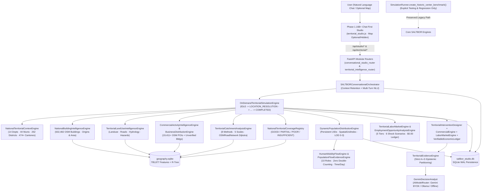

# SALTBOR Phase 1.17 — Architecture Diagram, Database Migrations, API Contracts & Evidence Schema

---

## 1. Updated System Architecture Diagram (Deliverable 4)



---

## 2. Database Migrations (Deliverable 6)

### 2.1 Spatial Geography Database (`saltbor/datasets/gis/ingested/geography.sqlite`)
Materialized via [`saltbor/datasets/gis/pipeline.py`](file:///c:/GIT%20HUB/sv%20people/saltbor/datasets/gis/pipeline.py) from the vendored Geofabrik El Salvador extract (ODbL-1.0) into **15 layers** totaling **795,877 real features**:
- **New Layers Added**: `pois_a` (11,400 polygon POIs), `pofw` (448), `pofw_a` (947), `transport_a` (118), `protected_areas` (220).
- **National Buildings Coverage**: Upgraded from 989 Historic-Center-only polygons to **632,482** national building footprints (`yes` and untyped rows conservatively classified as `unknown`).
- **R-Tree Spatial Virtual Table**:
  ```sql
  CREATE VIRTUAL TABLE IF NOT EXISTS geographic_features_rtree USING rtree(
      id, min_lon, max_lon, min_lat, max_lat
  );
  ```
  Joined via `gf.rowid = r.id` across `features_in_bbox`, `count_in_bbox`, `geojson`, `nearest_road`, `nearest_features`, and `ecological_profile` in read-only URI mode (`mode=ro`).

### 2.2 Conversational & Territorial Intelligence Store (`saltbor_studio.db` — SQLite WAL)
Additive schema migration v2 applied idempotently in [`ConversationalPersistenceStore._ensure_schema()`](file:///c:/GIT%20HUB/sv%20people/saltbor/conversational/persistence.py):
- `studio_schema_meta`: tracks `phase_117_schema_version = 2`.
- `territorial_scenarios`: stores `scenario_id`, lifecycle `state`, `state_history_json`, `location_query`, `district_id`, `department_code`, `lat`, `lon`, `catchment_json`, `seed`, `parameters_json`, `provenance_json`, `is_historic_benchmark`, `record_json`.
- `territorial_evidence_packages`: stores `package_id`, `scenario_id`, `seed`, separated `tier_a_json`..`tier_g_json`, and `summary_json`.
- `territorial_coverage_cache`: stores cached district/department coverage evaluations.
- `persistent_population_assignments`: persists synthetic human `uid`, `home_district_id`, `current_district_id`, `household_id`, `(lat, lon)`, and `residential_building_id` across scenarios.

---

## 3. REST API Contracts (Deliverable 7)

All existing endpoints (`/api/status`, `/api/world`, `/api/gis/*`, `/api/studio/*`, `/api/territory/*`, `/api/ai/*`) remain backward-compatible. Server startup via `create_app()` in [`saltbor/visualization/server.py`](file:///c:/GIT%20HUB/sv%20people/saltbor/visualization/server.py) now boots into `IDLE_ON_DEMAND` (`active_population = 0`, `historic_center_active = False`).

New modular sub-router [`territorial_intelligence_router.py`](file:///c:/GIT%20HUB/sv%20people/saltbor/visualization/routers/territorial_intelligence_router.py) mounted under `/api/territorial`:

| Method & Path | Purpose | Key Parameters / Payload |
| :--- | :--- | :--- |
| `GET /api/territorial/status` | Engine lifecycle state & R-Tree status | None (`historic_center_is_default: false`) |
| `POST /api/territorial/scenarios` | Construct & execute on-demand scenario | `location_query`, `lat`, `lon`, `objective`, `service_type`, `catchment_method`, `catchment_scale`, `horizon_days`, `seed`, `employment_intervention_kind`, `compare_with_baseline` |
| `GET /api/territorial/scenarios` | List active session scenarios | None |
| `GET /api/territorial/scenarios/{scenario_id}` | Fetch scenario record + A–G evidence | `scenario_id` |
| `POST /api/territorial/scenarios/{scenario_id}/pause` | Pause scenario execution | `scenario_id` |
| `POST /api/territorial/scenarios/{scenario_id}/resume` | Resume paused scenario | `scenario_id` |
| `POST /api/territorial/scenarios/{scenario_id}/cancel` | Cancel scenario safely | `scenario_id` |
| `POST /api/territorial/scenarios/{scenario_id}/rerun` | Re-execute with optional new seed | `seed` (optional query param) |
| `POST /api/territorial/scenarios/compare` | Compare 2–6 locations independently | `location_queries`, `objective`, `service_type`, `horizon_days`, `seed` |
| `POST /api/territorial/benchmark/historic-center` | Explicitly invoke preserved Historic Center benchmark | `seed` |
| `GET /api/territorial/buildings` | Building intelligence & origins | `query` or `lat`/`lon`, `radius_km` |
| `GET /api/territorial/commerce` | Confirmed establishments & unverified buildings | `query` or `lat`/`lon`, `radius_km`, `category` |
| `GET /api/territorial/catchment` | Adaptive area of influence + GeoJSON hull | `query` or `lat`/`lon`, `service_type`, `method`, `scale` |
| `GET /api/territorial/mobility` | 10-role flows, corridors, OD patterns | `query` or `lat`/`lon`, `time_period`, `day_type` |
| `GET /api/territorial/employment` | 5-tier employment opportunity analysis | `query` or `lat`/`lon` |
| `POST /api/territorial/employment/intervention` | Simulate employment shock with `$0.00` ledger audit | `location_query`/`lat`/`lon`, `intervention_kind`, `horizon_days`, `custom_jobs_delta`, `seed` |
| `GET /api/territorial/coverage` | National 14-dept / 262-district coverage registry | `department_code` (optional filter) |
| `GET /api/territorial/coverage/geojson` | GeoJSON overlay for coverage tiers | None |

---

## 4. Evidence & Provenance Schema (Deliverable 10)

Defined in [`saltbor/territorial_intelligence/schemas.py`](file:///c:/GIT%20HUB/sv%20people/saltbor/territorial_intelligence/schemas.py) and built by [`TerritorialEvidenceEngine`](file:///c:/GIT%20HUB/sv%20people/saltbor/territorial_intelligence/evidence.py):

- **`TerritorialEvidenceIndicator`**: `indicator_id`, `name`, `value`, `unit`, `epistemic_tier` (`A`..`G`), `geographic_scope`, `population_scope`, `time_interval`, `source_engine`, `calculation_method`, `data_provenance`, `data_quality`, `confidence`, `confidence_interval_95`, `simulation_seed`, `scenario_id`, `limitations`.
- **`TerritorialEvidencePackage`**: strictly partitioned into:
  - `A_real_observed_data` (OSM buildings, roads, confirmed establishments, unverified commercial buildings; `measured_pedestrian_sensor_flows` explicitly `None`)
  - `B_official_statistical_estimates` (D.L. 762 population, EHPM informal priors, `verified_job_vacancies` count `0`)
  - `C_geographic_derivations` (catchment area, road circuity, commercial density, Shannon diversity, jobs-workers mismatch)
  - `D_synthetic_population_characteristics` (hydrated cohort count, mean liquidity, diurnal schedule heterogeneity entropy)
  - `E_simulated_outcomes` (commerce/labor/service outcomes, `$0.00` conservation diff, model-generated mobility index)
  - `F_ai_interpretations_and_hypotheses` (grounding-verified interpretations & opportunity hypotheses)
  - `G_recommendations` (analytical verdict & limitations)
