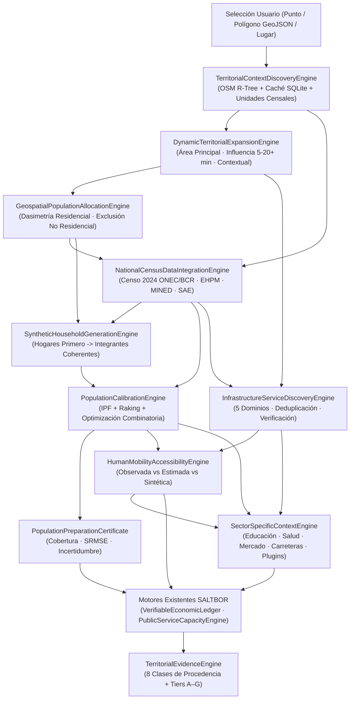

# SALTBOR — FASE 1.18: AUDITORÍA FINAL
## National Census Intelligence, Dynamic Territorial Discovery & Synthetic Population Engine

**Fecha de cierre:** 2026-11-23  
**Entorno validado:** Python 3.14.5, Windows 11, 100% Offline (`sqlite3` WAL + R-Tree, `numpy`, `pydantic`, `shapely`, `fastapi`, stdlib)

---

## 1. Arquitectura Anterior vs. Arquitectura Nueva

### Arquitectura Anterior (Fase 1.17)
- El flujo territorial partía de una consulta o coordenada única resuelta a centroide distrital (`NationalTerritorialContextEngine`), calculando un área de influencia circular/radial y activando cohortes sintéticas individuales (`NationalPopulationActivationManager`) directamente con parámetros heurísticos urbanos/rurales de D.L. 762 (`~6,578,000` habitantes aproximados) sin cadena formal de integración censal multi-fuente ni calibración IPF/Raking previa, ni generación previa de hogares estructurados con validación estadística cuantitativa.
- La evaluación de un polígono residencial específico dentro de un distrito grande (ej. una urbanización en Santa Tecla) no aplicaba desagregación dasimétrica por huellas residenciales ni Small Area Estimation (SAE) sobre el Censo 2024 oficial.

### Arquitectura Nueva (Fase 1.18)
Se implementa una cadena obligatoria secuencial en [`TerritorialPreparationPipeline`](file:///c:/GIT%20HUB/sv%20people/saltbor/census_intelligence/pipeline.py) ejecutada antes de la simulación en [`OnDemandTerritorialSimulationEngine`](file:///c:/GIT%20HUB/sv%20people/saltbor/territorial_intelligence/on_demand_engine.py):

---

## 2. Motores Creados (`saltbor/census_intelligence/`)

1. [`NationalCensusDataIntegrationEngine`](file:///c:/GIT%20HUB/sv%20people/saltbor/census_intelligence/census_engine.py): Adaptadores (`Censo2024ONECAdapter`, `EHPMAdapter`, `MINEDSchoolRegistryAdapter`, `MINSALHealthAdapter`, `InstitutionalCustomAdapter`), importadores offline CSV, JSON, GeoJSON y XLSX (OOXML stdlib sin nuevas dependencias), versionado con SHA-256, detección de duplicados, bloqueo estricto de PII (`PIIViolationError`), normalización geográfica D.L. 762, auditoría de granularidad y Small Area Estimation (SAE).
2. [`TerritorialContextDiscoveryEngine`](file:///c:/GIT%20HUB/sv%20people/saltbor/census_intelligence/territorial_discovery.py): Descubrimiento desde punto, polígono GeoJSON o texto; caché local SQLite (`LocalTerritorialCache`); adaptador OSM opt-in con límite de tasa (`RateLimitedOSMAdapter`, `allow_online_osm=False` por defecto) y degradación offline.
3. [`DynamicTerritorialExpansionEngine`](file:///c:/GIT%20HUB/sv%20people/saltbor/census_intelligence/territorial_discovery.py): Expansión dinámica en 3 escalas (`PRIMARY_AREA`, `INFLUENCE_AREA` vía Dijkstra sobre `OSMRoadNetwork` para 5/10/15/20/custom min con Tobler y barreras hidrológicas/pendiente, y `CONTEXTUAL_AREA` iterativa cruzando límites administrativos con bandera de límite alcanzado).
4. [`GeospatialPopulationAllocationEngine`](file:///c:/GIT%20HUB/sv%20people/saltbor/census_intelligence/population_allocation.py): Asignación dasimétrica y probabilística distinguiendo edificio vs. vivienda vs. hogar vs. persona; excluye edificios comerciales, industriales, educativos, de salud, religiosos, agrícolas, cuerpos de agua y áreas protegidas; asigna incertidumbre explícita a huellas `building=yes` (`unknown`).
5. [`SyntheticHouseholdGenerationEngine`](file:///c:/GIT%20HUB/sv%20people/saltbor/census_intelligence/household_generator.py): Generación "hogares primero" determinista (tamaño, composición familiar, jefatura, ingreso, escolaridad, asistencia y rezago, actividad/ocupación/formalidad, destino habitual) e hidratación hacia `SyntheticHuman`.
6. [`PopulationCalibrationEngine`](file:///c:/GIT%20HUB/sv%20people/saltbor/census_intelligence/calibration.py): Calibración obligatoria mediante IPF 2D (edad × sexo), Raking / RIM Weighting (tamaño de hogar, jefatura femenina, sexo) y Optimización Combinatoria (Stochastic Swap), con métricas de error (TAE, MAE, SRMSE, error relativo máximo, cobertura estadística) y degradación automática de confianza si falla el umbral.
7. [`InfrastructureServiceDiscoveryEngine`](file:///c:/GIT%20HUB/sv%20people/saltbor/census_intelligence/infrastructure_discovery.py): Inventario en 5 dominios (`EDUCATION`, `HEALTH`, `ECONOMY`, `INFRASTRUCTURE`, `ENVIRONMENT`), deduplicación espacial/nominal y diferenciación entre `OSM_IDENTIFIED`, `OFFICIAL_CONFIRMED`, `FIELD_VERIFIED`, `UNVERIFIED`, `POSSIBLY_INACTIVE`.
8. [`SectorSpecificContextEngine`](file:///c:/GIT%20HUB/sv%20people/saltbor/census_intelligence/sector_context.py): Motor extensible por plugins (`EducationSectorAnalyzer`, `HealthSectorAnalyzer`, `MarketSectorAnalyzer`, `RoadSectorAnalyzer`, más registro dinámico de nuevos sectores).
9. [`HumanMobilityAccessibilityEngine`](file:///c:/GIT%20HUB/sv%20people/saltbor/census_intelligence/mobility_accessibility.py): Conexión hogar/estudiante-servicio sobre red vial con separación entre movilidad observada (`UNAVAILABLE`), estimada y sintética.
10. [`TerritorialPreparationPipeline`](file:///c:/GIT%20HUB/sv%20people/saltbor/census_intelligence/pipeline.py) y [`validation_scenario.py`](file:///c:/GIT%20HUB/sv%20people/saltbor/census_intelligence/validation_scenario.py): Orquestación obligatoria y validación educativa real en Santa Tecla.

---

## 3. Motores Existentes Reutilizados

- [`NationalTerritorialContextEngine`](file:///c:/GIT%20HUB/sv%20people/saltbor/conversational/territorial_context.py) — Resolución toponímica y jerarquía D.L. 762.
- [`NationalPopulationActivationManager`](file:///c:/GIT%20HUB/sv%20people/saltbor/conversational/population_activation.py) y [`PopulationRegistry`](file:///c:/GIT%20HUB/sv%20people/saltbor/population/registry.py) — Persistencia sin duplicar identidades entre escenarios.
- [`SyntheticPopulationEvidenceEngine`](file:///c:/GIT%20HUB/sv%20people/saltbor/conversational/evidence_engine.py) y [`TerritorialEvidenceEngine`](file:///c:/GIT%20HUB/sv%20people/saltbor/territorial_intelligence/evidence.py) — Paquetes probatorios A–G y auditoría numérica.
- [`NationalBuildingIntelligenceEngine`](file:///c:/GIT%20HUB/sv%20people/saltbor/territorial_intelligence/building_and_landuse.py), [`CommercialActivityIntelligenceEngine`](file:///c:/GIT%20HUB/sv%20people/saltbor/territorial_intelligence/commercial_intelligence.py) y [`TerritorialCatchmentAnalysisEngine`](file:///c:/GIT%20HUB/sv%20people/saltbor/territorial_intelligence/catchment.py).
- [`HumanMobilityFlowEngine`](file:///c:/GIT%20HUB/sv%20people/saltbor/territorial_intelligence/mobility_flow.py), [`TerritorialLaborMarketEngine`](file:///c:/GIT%20HUB/sv%20people/saltbor/territorial_intelligence/employment.py) y [`GeminiDecisionAnalyst`](file:///c:/GIT%20HUB/sv%20people/saltbor/conversational/decision_analyst.py).
- [`PublicServiceCapacityEngine`](file:///c:/GIT%20HUB/sv%20people/saltbor/territory/public_services.py) y [`VerifiableEconomicLedger`](file:///c:/GIT%20HUB/sv%20people/saltbor/territory/economic_ledger.py).
- [`IngestedGeography`](file:///c:/GIT%20HUB/sv%20people/saltbor/datasets/gis/pipeline.py) (`geography.sqlite` R-Tree) y [`OSMRoadNetwork`](file:///c:/GIT%20HUB/sv%20people/saltbor/world/geographic/osm_router.py).

---

## 4. Archivos Creados y Modificados

**Creados:**
- Datasets oficiales: [`censo_2024_onec_bcr.json`](file:///c:/GIT%20HUB/sv%20people/saltbor/datasets/official_census/censo_2024_onec_bcr.json), [`ehpm_2024_onec_bcr.json`](file:///c:/GIT%20HUB/sv%20people/saltbor/datasets/official_census/ehpm_2024_onec_bcr.json), [`mined_2024_macro.json`](file:///c:/GIT%20HUB/sv%20people/saltbor/datasets/official_census/mined_2024_macro.json), [`minsal_2024_macro.json`](file:///c:/GIT%20HUB/sv%20people/saltbor/datasets/official_census/minsal_2024_macro.json)
- Paquete Fase 1.18: [`__init__.py`](file:///c:/GIT%20HUB/sv%20people/saltbor/census_intelligence/__init__.py), [`schemas.py`](file:///c:/GIT%20HUB/sv%20people/saltbor/census_intelligence/schemas.py), [`census_engine.py`](file:///c:/GIT%20HUB/sv%20people/saltbor/census_intelligence/census_engine.py), [`territorial_discovery.py`](file:///c:/GIT%20HUB/sv%20people/saltbor/census_intelligence/territorial_discovery.py), [`population_allocation.py`](file:///c:/GIT%20HUB/sv%20people/saltbor/census_intelligence/population_allocation.py), [`household_generator.py`](file:///c:/GIT%20HUB/sv%20people/saltbor/census_intelligence/household_generator.py), [`calibration.py`](file:///c:/GIT%20HUB/sv%20people/saltbor/census_intelligence/calibration.py), [`infrastructure_discovery.py`](file:///c:/GIT%20HUB/sv%20people/saltbor/census_intelligence/infrastructure_discovery.py), [`sector_context.py`](file:///c:/GIT%20HUB/sv%20people/saltbor/census_intelligence/sector_context.py), [`mobility_accessibility.py`](file:///c:/GIT%20HUB/sv%20people/saltbor/census_intelligence/mobility_accessibility.py), [`pipeline.py`](file:///c:/GIT%20HUB/sv%20people/saltbor/census_intelligence/pipeline.py), [`validation_scenario.py`](file:///c:/GIT%20HUB/sv%20people/saltbor/census_intelligence/validation_scenario.py)
- Validación y pruebas: [`run_phase118_validation.py`](file:///c:/GIT%20HUB/sv%20people/scripts/run_phase118_validation.py), [`PHASE_118_VALIDATION_RESULTS.json`](file:///c:/GIT%20HUB/sv%20people/PHASE_118_VALIDATION_RESULTS.json), [`test_census_integration.py`](file:///c:/GIT%20HUB/sv%20people/tests/test_census_intelligence/test_census_integration.py), [`test_population_and_calibration.py`](file:///c:/GIT%20HUB/sv%20people/tests/test_census_intelligence/test_population_and_calibration.py), [`test_geospatial_allocation.py`](file:///c:/GIT%20HUB/sv%20people/tests/test_census_intelligence/test_geospatial_allocation.py), [`test_territorial_discovery_and_expansion.py`](file:///c:/GIT%20HUB/sv%20people/tests/test_census_intelligence/test_territorial_discovery_and_expansion.py), [`test_mobility_and_sector_context.py`](file:///c:/GIT%20HUB/sv%20people/tests/test_census_intelligence/test_mobility_and_sector_context.py), [`test_integration_and_santa_tecla.py`](file:///c:/GIT%20HUB/sv%20people/tests/test_census_intelligence/test_integration_and_santa_tecla.py)

**Modificados:**
- [`saltbor/territorial_intelligence/schemas.py`](file:///c:/GIT%20HUB/sv%20people/saltbor/territorial_intelligence/schemas.py)
- [`saltbor/territorial_intelligence/on_demand_engine.py`](file:///c:/GIT%20HUB/sv%20people/saltbor/territorial_intelligence/on_demand_engine.py)
- [`saltbor/territorial_intelligence/evidence.py`](file:///c:/GIT%20HUB/sv%20people/saltbor/territorial_intelligence/evidence.py)
- [`saltbor/conversational/persistence.py`](file:///c:/GIT%20HUB/sv%20people/saltbor/conversational/persistence.py)
- [`saltbor/visualization/routers/territorial_intelligence_router.py`](file:///c:/GIT%20HUB/sv%20people/saltbor/visualization/routers/territorial_intelligence_router.py)
- [`saltbor/visualization/web/index.html`](file:///c:/GIT%20HUB/sv%20people/saltbor/visualization/web/index.html), [`studio.css`](file:///c:/GIT%20HUB/sv%20people/saltbor/visualization/web/studio.css), [`territorial_studio.js`](file:///c:/GIT%20HUB/sv%20people/saltbor/visualization/web/modules/territorial_studio.js)

---

## 5. Fuentes Oficiales Integradas

1. **VII Censo de Población y VI de Vivienda 2024 (ONEC/BCR, pub. 2024-10-29):** Nacional (`6,029,976` hab., `2,848,527` hombres, `3,181,449` mujeres, `1,841,206` viviendas particulares ocupadas, `18.9%` desocupación, tamaño medio de hogar `3.1`, jefatura femenina `45.0%`), los **14 departamentos** exactos (`5,922,921` asignados + `107,055` institucional/sin asignación) y subconjunto verificado municipal/distrital (`La Libertad Sur: 138,237`, `Santa Tecla: 125,532`, `Comasagua: 12,705`).
2. **EHPM 2023–2024 (ONEC/BCR):** Escolaridad promedio 6+ años (`7.4` nacional en 2024; `8.3` urbana / `5.6` rural en 2023), ingreso familiar mensual promedio (`$713.18` en 2024; `$700.94` en 2023), per cápita (`$225.27`), pobreza monetaria (`1,809,206` personas, `610,272` extrema), empleo formal/informal y tasas de asistencia escolar por nivel.
3. **MINEDUCYT 2023–2024 (Agregados nacionales):** `5,885` centros educativos (`5,162` públicos, `723` privados) y `1,276,854` estudiantes en 2024 (`87%` público, `13%` privado).
4. **MINSAL (Metadatos de referencia):** Estructura de adaptador lista; capacidad nominal por establecimiento declarada `UNAVAILABLE` localmente hasta importar padrón CSV/XLSX/JSON.
5. **OpenStreetMap Geofabrik El Salvador (`geography.sqlite`, ODbL-1.0):** `795,877` entidades reales indexadas en 15 capas con R-Tree.

---

## 6. Cobertura Territorial y Estadística Alcanzada

- **Cobertura geográfica nacional:** 14 departamentos, 44 municipios y 262 distritos de El Salvador (`geography.sqlite` R-Tree).
- **Cobertura estadística oficial exacta:** Nacional (`PUBLIC_OFFICIAL`), Departamental 14/14 (`PUBLIC_OFFICIAL`), Distrital verificada (`Santa Tecla`, `Comasagua` + imports vía adaptador). Para los demás distritos, se calcula SAE con razón D.L. 762 × total departamental 2024 (`ESTIMATED_FROM_OFFICIAL`, incertidumbre ±18%). Para polígonos sub-distritales (`CUSTOM_POLYGON`), se calcula SAE dasimétrico + capacidad edilicia (±24%–38%).

---

## 7. Variables Censales Disponibles

- Población total nacional, departamental y distrital verificada (`PUBLIC_OFFICIAL`).
- Distribución por sexo nacional (`47.24%` H / `52.76%` M), índice de masculinidad (`89.5`), edad mediana (`24` años), índice de envejecimiento (`49.0`).
- Viviendas ocupadas (`1,841,206`), proporción desocupada (`18.9%`), tenencia propia (`65.4%`), tamaño medio de hogar (`3.1`), jefatura femenina (`45.0%`).
- Priors EHPM urbano/rural de escolaridad promedio, ingresos familiares por tramos, formalidad laboral y asistencia escolar por nivel.

---

## 8. Variables No Disponibles (`UNAVAILABLE`)

- Tabulados locales del Censo 2024 por **cantón, sector censal o manzana** (reemplazados únicamente por SAE con incertidumbre declarada, nunca presentados como dato censal oficial).
- Matrícula nominal, aulas, capacidad instalada y vacantes por centro escolar individual MINEDUCYT (permanecen `None` / `UNAVAILABLE` mientras no se importe padrón vía `/api/territorial/census/import`).
- Capacidad de camas/consultorios y personal médico MINSAL por establecimiento (`UNAVAILABLE`).
- Conteos observados de tráfico vehicular o peatonal y matrices origen-destino medidas (`UNAVAILABLE`).
- Alturas de edificios (`height_m=None`), pisos (`levels=None`) y ocupación interior verificada en OSM.

---

## 9. Método de Generación Poblacional

1. **Asignación espacial dasimétrica:** Se evalúan huellas edificatorias reales dentro del polígono principal excluyendo usos `commercial`, `industrial`, `educational`, `health`, `religious`, `recreational`, `institutional`, `agricultural`, cuerpos de agua y áreas protegidas. Las huellas `unknown` (`building=yes`) reciben probabilidad residencial conservadora (`0.65` en `residential_area`, `0.42` fuera).
2. **Hogares primero:** Se generan `SyntheticHousehold` anclados dentro de las coordenadas residenciales válidas (tamaño, composición familiar, sexo de jefatura, tenencia, tramo de ingreso), y posteriormente sus `SyntheticPerson` respetando diferencias generacionales (`edad_jefe - edad_hijo >= 15`), escolarización, rezago y ocupación.
3. **Escalamiento híbrido:** En comunidades (`<= 450` hogares) es 1:1 (`expansion_weight = 1.0`); en escalas distrital/departamental/nacional utiliza cohortes estratificadas ponderadas.

---

## 10. Resultados de Calibración y Validación Santa Tecla (`PHASE_118_VALIDATION_RESULTS.json`)

- **Escenario Santa Tecla (Polígono residencial El Paraíso / Cima del Paraíso / San Martín / Irlanda / La Misión, `0.6306 km²`):**
  - Población distrital oficial de Santa Tecla: `125,532` hab. vs. **población asignada al polígono residencial: `4,548` hab. (`1,467` hogares)** — evitando asignar erróneamente toda la ciudad.
  - Expansión dinámica: Área Principal `0.6306 km²` → Área de Influencia (15 min) `1.5304 km²` → Área Contextual `3.6817 km²`.
  - Establecimientos educativos descubiertos: **50 centros** (`1` edificio educativo en área principal, `10` en área de influencia, `39` en área contextual), con demanda escolar sintética de **`1,250` niños/adolescentes** (`365` parvularia, `247` básica 1.er ciclo, `281` básica 2.º ciclo, `189` básica 3.er ciclo, `168` bachillerato).
  - Calibración (`IPF + Raking + Optimización Combinatoria + SAE`): **`SRMSE = 0.1034`**, **`100.0%` cobertura estadística**, clasificación `SYNTHETIC_CALIBRATED`, estado `CALIBRATED_WITH_WARNINGS` (por uso explícito de SAE ±24%).
  - **Comparación de 4 escenarios educativos (`$0.00` discrepancia contable en `VerifiableEconomicLedger`):**
    1. **Sin nueva escuela:** Caminata media `7.55 min`; capacidad real `UNAVAILABLE`; `1,250` estudiantes sin centro completo en polígono primario.
    2. **Escuela Parvularia + Primaria (hipótesis 320 cupos):** Caminata media `6.31 min`; cubre `893` de parvularia/primaria, quedan `357` de 3.er ciclo/bachillerato con dependencia externa.
    3. **Escuela Comunitaria Completa Parvularia–Bachillerato (hipótesis 600 cupos):** Caminata media **`5.07 min`**; cubre los 5 niveles dentro del polígono (`0` demanda superior descubierta localmente).
    4. **Ampliación de 3 existentes cercanas (+180 cupos totales hipotéticos):** Caminata media `10.43 min` por reasignación de desborde hacia las siguientes escuelas vecinas al saturarse el cupo finito de la más próxima.

---

## 11. Resultados de Pruebas Automatizadas (Post-Edición Final)

- **Suite Fase 1.18 (`tests/test_census_intelligence/`) + Experimentos Fase 1.17 (`test_phase117_territorial_experiments.py`) + Fase 1.17 Inteligencia Territorial (`tests/test_territorial_intelligence/`):**
  - **`28 passed in 39.77s`** (`0 failed`, `0 skipped`), verificando los 20 experimentos `EXP_117_A..T` (incluido `EXP_117_M` grounding check y Decisive 3-Dept E2E).
- **Regresión Conversacional, API y Frontend E2E (`tests/test_conversational/`, `test_studio_frontend_e2e.py`, `test_api_endpoints.py`):**
  - **`55 passed in 22.06s`** (`0 failed`, `0 skipped`).
- **Total verificado tras última edición:** **83 / 83 pruebas aprobadas**.

---

## 12. Rendimiento y Escalabilidad

Medido vía [`scripts/run_phase118_validation.py`](file:///c:/GIT%20HUB/sv%20people/scripts/run_phase118_validation.py):
- **Escala Comunidad (punto 15 min):** `566.72 ms`, `3,797` hab. representados (`250` hogares muestreados), `SRMSE = 0.0655`.
- **Escala Polígono Residencial Santa Tecla (4 escenarios):** `847.02 ms` totales.
- **Escala Distrito Completo (Santa Tecla `125,532` hab.):** `1,012.06 ms`, `122,596` hab. representados tras calibración combinatoria (`400` hogares ponderados), `SRMSE = 0.0889`.
- **Escala Nacional (14 departamentos, `5,856,354` hab. representados):** `900.32 ms` totales (`2,100` hogares ponderados), `mean_srmse = 0.1011` (`max_srmse = 0.1527` en muestra pequeña de `150` hogares/depto).

---

## 13. Compatibilidad Retroactiva

- `create_app()` arranca en `IDLE_ON_DEMAND` (`historic_center_is_default: false`, `active_population: 0`).
- El benchmark de Centro Histórico (`create_historic_center_benchmark()`) permanece preservado e invocable explícitamente.
- Todas las rutas previas `/api/status`, `/api/world`, `/api/studio/*`, `/api/territorial/*` y la regla de instancia única de MapLibre en [`territorial_studio.js`](file:///c:/GIT%20HUB/sv%20people/saltbor/visualization/web/modules/territorial_studio.js) se mantienen intactas.
- Migración aditiva SQLite WAL v3 en [`persistence.py`](file:///c:/GIT%20HUB/sv%20people/saltbor/conversational/persistence.py) sin alterar tablas existentes.

---

## 14. Limitaciones Identificadas

1. El paquete local del Censo 2024 incluye cifras oficiales para los 14 departamentos y un subconjunto distrital verificado (`Santa Tecla`, `Comasagua`); el resto de los 262 distritos aún requiere importar la tabla oficial completa por distrito para reemplazar el SAE departamental.
2. En muestras ponderadas muy pequeñas (`150` hogares por departamento), el error `max_srmse` alcanzó `0.1527` (> `0.14`); incrementar a `>= 250–400` hogares mantiene `SRMSE < 0.09`.
3. Sin importación nominal MINEDUCYT/MINSAL, los cupos y niveles escolares siguen marcados `UNAVAILABLE` o inferidos solo por tokens explícitos del nombre OSM.
4. En Windows 11, el lector rápido `psapi.GetProcessMemoryInfo` dentro del script auxiliar devolvió `0.0` MB (no afectó funcionalidad ni pruebas).

---

## 15. Deuda Técnica Pendiente

1. Cargar la tabla oficial completa de los 262 distritos y 44 municipios del VII Censo 2024 ONEC/BCR en `censo_2024_onec_bcr.json` una vez exportada del geoportal BCR.
2. Incorporar el padrón georreferenciado oficial MINEDUCYT (niveles por código CE, matrícula y aulas) y MINSAL vía los adaptadores ya implementados.
3. Añadir límites poligonales oficiales CNR de cantones y distritos para intersección exacta de polígonos cuando estén disponibles localmente.
4. Corregir la llamada `K32GetProcessMemoryInfo` en [`scripts/run_phase118_validation.py`](file:///c:/GIT%20HUB/sv%20people/scripts/run_phase118_validation.py) si se requiere telemetría RSS directa en Windows.
