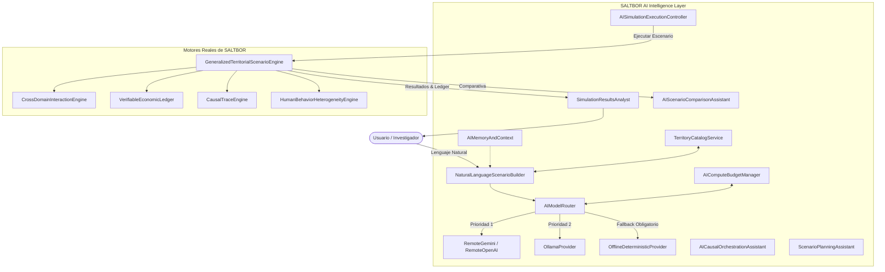

# SALTBOR AI INTELLIGENCE LAYER (PHASE 1.15)
## ARQUITECTURA MODULAR, TRADUCCIÓN UNIVERSAL Y ORQUESTACIÓN CIENTÍFICA

**Versión del Sistema**: SALTBOR Phase 1.15  
**Entorno de Ejecución**: Python 3.14.5 (Windows 11 host), SQLite WAL Mode, Local-First / 100% Offline  
**Marco Legal y Geográfico**: República de El Salvador (14 Departamentos, 44 Municipios, 262 Distritos según D.L. 762, CNR/IGN 2024)  
**Estado**: COMPLETADO Y VALIDADO MEDIANTE EXPERIMENTACIÓN  

---

### 1. Visión y Propósito

El módulo `SALTBOR_AI_INTELLIGENCE_LAYER` transforma a SALTBOR de un demostrador con configuraciones predeterminadas a una plataforma de simulación territorial asistida por inteligencia artificial.

La capa de IA permite a investigadores, planificadores y analistas de políticas públicas formular preguntas complejas en lenguaje natural ordinario (ej. *"¿Qué sucedería si un deslizamiento interrumpe por 14 días el camino en Cantón El Rosario?"*), traduciéndolas automáticamente en escenarios multidominio estructurados, evaluando la cobertura de datos de cualquier cantón salvadoreño, validando los mecanismos causales propuestos contra los motores físicos y económicos de SALTBOR, ejecutando la simulación determinista y analizando los resultados con estricta conservación contable de doble partida.

---

### 2. Principios Arquitectónicos Fundamentales

1. **La IA No Modifica la Realidad Simulada Directamente**: El LLM o motor semántico asiste, estructura, valida y analiza. Los motores de simulación (`CrossDomainInteractionEngine`, `RegionalEconomicNetworkEngine`, `PublicServiceCapacityEngine`, `HumanBehaviorHeterogeneityEngine`) retienen autoridad total sobre el estado del mundo y la dinámica por ticks.
2. **Conservación Contable Absoluta**: Cada movimiento financiero resultante se registra en un libro diario de doble partida (`VerifiableEconomicLedger`). La IA jamás crea dinero, salarios o subsidios sin contrapartida ($\sum \text{Débitos} \equiv \sum \text{Créditos}$).
3. **Resiliencia Local-First y Fallback Transparente**: La plataforma opera incondicionalmente sin conexión a Internet ni claves de pago mediante `OfflineDeterministicProvider`.
4. **Preservación Inmutable de Línea Base**: Ninguna ejecución experimental altera ni contamina los estados persistentes de los agentes o la línea base en equilibrio.
5. **Diferenciación Epistémica y Rechazo de Alucinaciones**: Los mecanismos causales se auditan contra `KNOWN_SCIENTIFIC_MECHANISMS`. Cualquier relación no fundamentada se etiqueta como `HYPOTHESIS_PENDING_VALIDATION`.

---

### 3. Diagrama Estructural del Módulo

---

### 4. Mapeo de Componentes

| Módulo | Archivo | Responsabilidad Principal |
| :--- | :--- | :--- |
| **`BaseAIProvider`** | [saltbor/ai/providers/base.py](file:///c:/GIT%20HUB/sv%20people/saltbor/ai/providers/base.py) | Abstracción agnóstica de proveedores, dataclasses de petición/respuesta y contabilidad de tokens. |
| **`OfflineDeterministicProvider`** | [saltbor/ai/providers/deterministic.py](file:///c:/GIT%20HUB/sv%20people/saltbor/ai/providers/deterministic.py) | Inferencia y extracción semántica offline determinista basada en el catálogo nacional salvadoreño. |
| **`OllamaProvider`** | [saltbor/ai/providers/ollama.py](file:///c:/GIT%20HUB/sv%20people/saltbor/ai/providers/ollama.py) | Integración HTTP local para modelos Llama 3.2, Mistral y Qwen con chequeo de salud y aislamiento de fallos. |
| **`RemoteGemini / RemoteOpenAI`** | [saltbor/ai/providers/remote.py](file:///c:/GIT%20HUB/sv%20people/saltbor/ai/providers/remote.py) | Adaptadores para APIs remotas con minimización de datos personales y timeouts controlados. |
| **`AIModelRouter`** | [saltbor/ai/router.py](file:///c:/GIT%20HUB/sv%20people/saltbor/ai/router.py) | Enrutador dinámico con conmutación por error (*failover*) automática. |
| **`AIComputeBudgetManager`** | [saltbor/ai/budget.py](file:///c:/GIT%20HUB/sv%20people/saltbor/ai/budget.py) | Monitoreo de tokens, presupuestos de gasto, auditoría de peticiones y caché in-memory. |
| **`TerritoryCatalogService`** | [saltbor/territory/territory_catalog.py](file:///c:/GIT%20HUB/sv%20people/saltbor/territory/territory_catalog.py) | Directorio de los 262 distritos y evaluación de cobertura de datos geográficos. |
| **`NaturalLanguageScenarioBuilder`** | [saltbor/ai/scenario_builder.py](file:///c:/GIT%20HUB/sv%20people/saltbor/ai/scenario_builder.py) | Compilador de lenguaje natural a especificaciones ejecutables `TerritorialScenarioDefinition`. |
| **`AICausalOrchestrationAssistant`** | [saltbor/ai/causal_orchestrator.py](file:///c:/GIT%20HUB/sv%20people/saltbor/ai/causal_orchestrator.py) | Validación científica de mecanismos causales y etiquetado de hipótesis no comprobadas. |
| **`ScenarioPlanningAssistant`** | [saltbor/ai/planning_assistant.py](file:///c:/GIT%20HUB/sv%20people/saltbor/ai/planning_assistant.py) | Formulación asistida de alternativas de intervención y diseño de experimentos. |
| **`AISimulationExecutionController`** | [saltbor/ai/execution_controller.py](file:///c:/GIT%20HUB/sv%20people/saltbor/ai/execution_controller.py) | Gobernanza del ciclo de vida (`DRAFT` $\rightarrow$ `VALIDATING` $\rightarrow$ `READY` $\rightarrow$ `RUNNING` $\rightarrow$ `COMPLETED`). |
| **`SimulationResultsAnalyst`** | [saltbor/ai/results_analyst.py](file:///c:/GIT%20HUB/sv%20people/saltbor/ai/results_analyst.py) | Interpretación científica basada estrictamente en los indicadores simulados y el balance contable. |
| **`AIScenarioComparisonAssistant`** | [saltbor/ai/scenario_comparator.py](file:///c:/GIT%20HUB/sv%20people/saltbor/ai/scenario_comparator.py) | Comparativa contrafactual multiescenario (Línea Base vs Shock vs Recuperación). |
| **`AIMemoryAndContext`** | [saltbor/ai/context.py](file:///c:/GIT%20HUB/sv%20people/saltbor/ai/context.py) | Particionamiento estricto de conocimiento y protección absoluta de memorias privadas individuales. |
